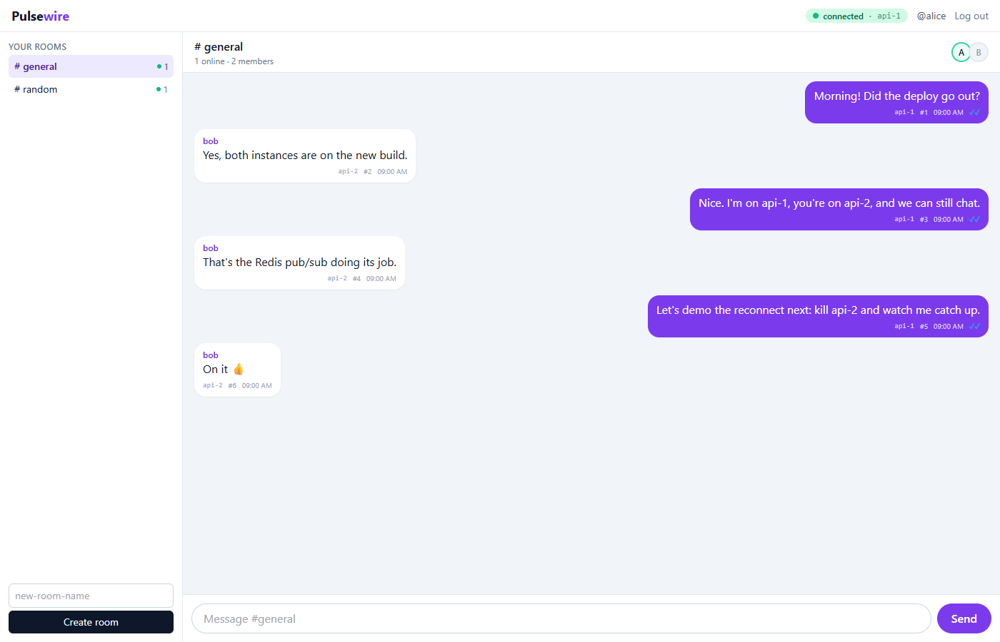
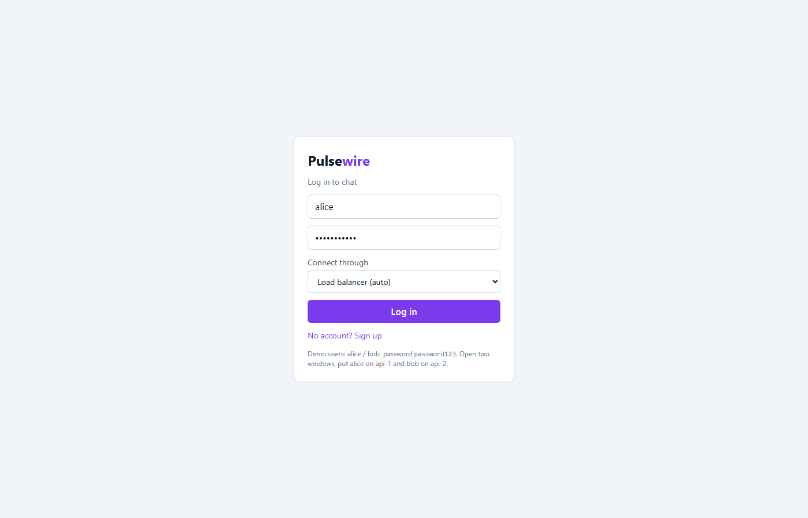
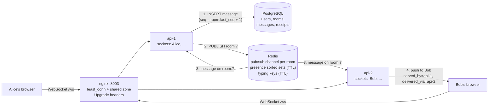

# Pulsewire

A mini Slack (rooms, history, online status, typing indicators, sent /
delivered / read ticks) built to show one thing in depth: **real-time
systems and how to scale them horizontally**. Two API instances sit behind
an nginx load balancer, and a user on api-1 chats live with a user on api-2
through Redis pub/sub.

## What this project demonstrates

- **Horizontal scaling of WebSockets.** Two instances, one Redis channel per room, subscribed only while a local socket is in that room. Every message shows the server that accepted it and the server that delivered it (`api-1 → api-2`). A control test with the Redis bus switched off proves why it is needed.
- **Load-tested:** 1,000 concurrent sockets split **500/500** by nginx; **60,000 of 60,000** deliveries arrived; p50 **11 ms**, p95 **23 ms** under steady traffic; **~170 KB per connection**.
- **Reliability you can explain:**
  - Messages are persisted before they are published, with a gapless per-room `seq`.
  - Sends are idempotent via `client_msg_id`.
  - Reconnection uses exponential backoff with jitter, then fetches exactly the missed messages (no duplicates, no gaps). There is a test for it while traffic keeps flowing.
- **Presence that handles real life:** 15 s heartbeats with TTLs in Redis. A closed laptop goes offline within ~30 s, and a test proves the TTL (not the socket close) does it. Multiple tabs across instances are handled correctly.
- **Honest engineering notes:**
  - nginx sent 100% of traffic to api-1 until I added a shared `zone`.
  - A 30 s test-suite stall turned out to be undrained client buffers.
  - Burst latency is ~300 ms, and an optimisation I expected to help did not.
- **25 tests** run two real uvicorn servers per test, plus `DECISIONS.md` (including pub/sub's limits and when Streams or Kafka would fix them) and `INTERVIEW.md`.

## Results

| Scenario (1,000 sockets, 20 rooms × 50, 2,000 deliveries/s) | p50 | p95 | p99 | Delivered | Split |
|---|---|---|---|---|---|
| Steady traffic | **10.8 ms** | **22.8 ms** | 61.0 ms | 60,000 / 60,000 | 500 / 500 |
| Burst (all senders at the same instant) | 317 ms | 453 ms | 541 ms | 60,000 / 60,000 | 500 / 500 |

Memory: 79 MB idle → 162 MB with 500 sockets per instance (~170 KB per
connection). Details and analysis: [docs/BENCHMARKS.md](docs/BENCHMARKS.md).


## Screenshots

| Chat: messages accepted by api-1 or api-2, ticks, online status | Login with server picker (load balancer / api-1 / api-2) |
|---|---|
|  |  |

Each bubble shows `served_by → delivered_via` (for example `api-2 → api-1`), its per-room sequence number, and sent / delivered / read ticks.

## Architecture



Message flow when Alice (on api-1) writes to #general:

1. api-1 checks membership, then in one transaction bumps `rooms.last_seq` (row lock) and inserts the message: **persist first**.
2. api-1 acks Alice with the seq (✓ sent), then `PUBLISH room:<id>`.
3. Every instance with a socket in that room is subscribed to the channel and receives the event.
4. Each instance pushes it to its local sockets through per-connection queues. Bob's client replies `delivered`, and later `read`; those receipts travel back the same way (✓✓, blue ✓✓).

If Bob was offline, his client reconnects with backoff and jitter. `hello`
tells it each room's latest seq, and it fetches `?after_seq=<last seen>`.

## Run it

Requirements: Docker with Compose.

```bash
docker compose up --build
```

| What | URL |
|---|---|
| Chat app | http://localhost:5173 |
| Load balancer / API (Swagger at `/docs`) | http://localhost:8003 |

### Demo: cross-server chat

1. Open http://localhost:5173, log in as **alice** / `password123`, and choose **"api-1 only"**.
2. Open http://127.0.0.1:5173 (a different origin, so a separate login), and log in as **bob** / `password123` with **"api-2 only"**.
3. Chat in #general. Each message shows `api-1 → api-2` (accepted by api-1, delivered by api-2). Watch the typing indicator, the ticks and the online dots.
4. `docker compose stop api-2`: Bob's badge turns *reconnecting*. Choose "Load balancer" (or restart api-2) and he reconnects with every missed message, none duplicated.

Watch the load balancer split connections:

```bash
curl localhost:8003/direct/api-1/metrics/instance
curl localhost:8003/direct/api-2/metrics/instance
```

## Tests

```bash
docker compose exec api-1 pytest -q
```

Each test starts **two real uvicorn servers** in-process (`test-1`, `test-2`) sharing a test database and Redis, and talks to them over real WebSockets:

- Alice on instance 1 and Bob on instance 2 exchange messages (`served_by` / `delivered_via` asserted)
- 6 users across 2 instances all receive every message in seq order
- Without the Redis bus, cross-server delivery fails (control experiment)
- Reconnect to the **other** instance while messages keep flowing: seqs 1..6, no gaps, no duplicates
- Resend after a lost ack is stored and broadcast once
- Presence: offline after an ungraceful disconnect via TTL; abrupt TCP drop; multi-tab across instances; idle socket closed with 4410
- Typing throttled server-side across instances; receipts monotonic and clamped; cursor pagination

## Docs

- [docs/DECISIONS.md](docs/DECISIONS.md): WebSockets vs polling vs SSE, pub/sub vs alternatives, pub/sub's limitations and how Redis Streams / Kafka fix them, every other choice
- [docs/BENCHMARKS.md](docs/BENCHMARKS.md): the 1,000-connection load test
- [docs/INTERVIEW.md](docs/INTERVIEW.md): 15 interview questions answered with this codebase

## Layout

```
backend/app/
  realtime/
    ws.py           WebSocket endpoint: auth, protocol, read loop, cleanup
    connections.py  per-socket queue + writer, local registry
    hub.py          fan-out to local sockets; pluggable bus
    redis_bus.py    Redis pub/sub, one channel per room
    presence.py     heartbeats + TTL (sorted set per user)
    sweeper.py      TTL-expiry detection, idle-socket close
    typing.py       throttled, short-lived typing keys
  chat.py           persist with per-room seq, cursor history
  receipts.py       delivered/read high-water marks
backend/benchmarks/load.py   1,000-socket load test
nginx/nginx.conf             load balancer with WebSocket upgrades
frontend/src/socket.ts       reconnect + backoff + jitter + resend
frontend/src/useChat.ts      merge by seq, gap detection, receipts
```
